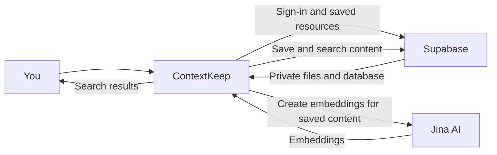

# ContextKeep

ContextKeep is a personal knowledge library for saving notes, code snippets, webpages, PDFs, and images, then finding them again with global semantic and keyword search. It is built for people who collect useful information across projects and need more than browser bookmarks or folders to retrieve it.

Working Link - https://context-search-ruby.vercel.app/

## What it does

- Save notes, links, and code snippets; organize resources with collections, tags, favorites, and workspaces.
- Upload private PDF and image files.
- Search across all of your workspaces with semantic and keyword retrieval. Results link to the original resource and show a relevant excerpt.
- Index text and code with Jina embeddings. Extract selectable PDF text for keyword and semantic search; use multimodal embeddings for PDFs and images.
- Keep user resources and uploaded files scoped to their owner with Supabase Auth, row-level security, and private Storage.

## Data flow



## Requirements

- [Bun](https://bun.sh/) 1.3.1 (the repository's package manager)
- A [Supabase](https://supabase.com/) project with Auth, PostgreSQL, and Storage
- A [Jina AI](https://jina.ai/) API key for embeddings and indexing
- Node.js 20.9 or later for Next.js 16

## Local setup

1. Install dependencies:

   ```sh
   bun install
   ```

2. Copy `.env.example` to `.env.local` and set your project values:

   ```dotenv
   NEXT_PUBLIC_SUPABASE_URL=https://your-project.supabase.co
   NEXT_PUBLIC_SUPABASE_PUBLISHABLE_KEY=your-supabase-publishable-key
   JINA_API_KEY=your-jina-api-key
   ```

   Optional settings:

   ```dotenv
   NEXT_PUBLIC_SITE_URL=http://localhost:3000
   NEXT_PUBLIC_CONTEXTKEEP_MAX_UPLOAD_SIZE_BYTES=10485760
   CONTEXTKEEP_MIN_COSINE_SIMILARITY=0.55
   ```

   `NEXT_PUBLIC_SITE_URL` should be your deployed HTTPS origin in production. The upload setting defaults to 10 MiB and can be configured up to 50 MiB; indexing has lower Jina limits for individual files. The similarity threshold is a server-only value from 0 to 1. Keep `.env.local` and all credentials out of version control.

3. In the Supabase SQL Editor, run every SQL file in `supabase/migrations/` in filename order. This creates the tables, ownership policies, private file bucket, search functions, and workspaces. Existing resources are assigned to a Personal workspace by the workspace migration.

4. In Supabase Auth, configure the site URL and allowed redirect URLs for local development and your deployed `/auth/callback` route. Configure email confirmation if you want account verification.

5. Start the development server:

   ```sh
   bun run dev
   ```

   Open [http://localhost:3000](http://localhost:3000).

For Vercel, set the same environment variables in the project settings and use the deployed origin for `NEXT_PUBLIC_SITE_URL`. Apply the Supabase migrations before deploying code that depends on them.

## Checks

```sh
bun run lint
bun test
bun run build
```

## Known limitations

- Scanned or image-only PDFs need OCR; ContextKeep currently extracts selectable text only.
- PDF text extraction is limited to 200 pages and 250,000 characters per document. Indexing also limits an individual PDF to 8 MB and images to 5 MB for Jina.
- A webpage must be publicly reachable and serve supported HTML for text extraction.
- Search quality depends on successful indexing and the configured Jina service. A saved resource can remain available even if indexing fails; retry indexing from search.
- This project does not provide team sharing or cross-user workspaces.

## Product write-up

**Problem and user.** ContextKeep helps people who save useful material across notes, code, articles, and documents but later struggle to find it. It is aimed at an individual researcher, student, or developer who wants one searchable personal library.

**Product decisions.** First, search is global across a user's workspaces, because choosing the right folder before searching creates friction. Second, semantic retrieval is combined with exact/full-text matching, so natural-language descriptions and distinctive identifiers can both find resources. Third, uploaded files stay private and ownership is enforced in the database; convenience does not justify exposing personal documents.

**Scope cuts and next steps.** The MVP skips team collaboration, OCR, and external reranking. With more time, I would add OCR for scanned documents, richer collection management and filtering, and a repeatable relevance-evaluation set using real user queries.

**Development surprises.** PDF.js's worker setup and browser-oriented globals caused server-runtime problems, so PDF extraction was isolated to the indexing path and its worker was configured explicitly. Search also needed real extracted PDF text—not placeholder multimodal labels—to find names inside resumes. These cases shaped the current file-indexing limits and retryable indexing flow.